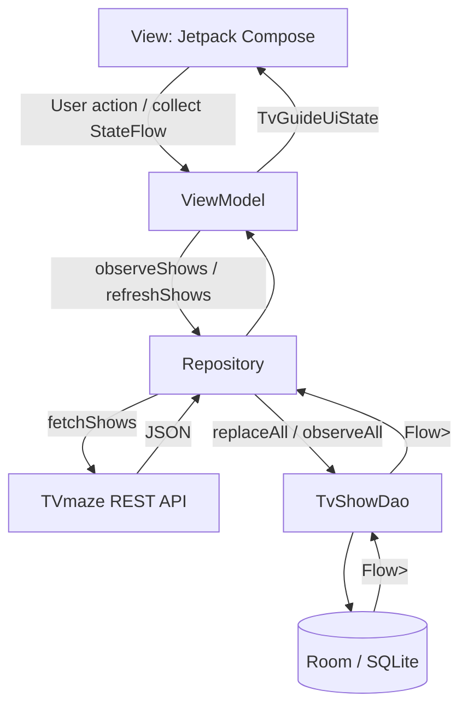

# Kiến trúc của TV Guide Offline

## Vai trò

- **View (Jetpack Compose):** chỉ hiển thị trạng thái và gửi thao tác của người dùng, ví dụ nhấn nút Làm mới.
- **ViewModel:** gọi Repository, quản lý trạng thái tải/lỗi/danh sách và xuất `StateFlow<TvGuideUiState>`.
- **Repository:** điểm truy cập thống nhất của ViewModel. Repository điều phối tải dữ liệu từ TVmaze và đọc/ghi cache Room.
- **Remote data source:** dùng Ktor gọi TVmaze REST API, giải mã JSON bằng Kotlin Serialization.
- **Local data source:** Room gồm Entity, DAO và Database; DAO phát `Flow` để giao diện nhận dữ liệu mới khi database thay đổi.

## Luồng online

1. ViewModel gọi `repository.refreshShows()`.
2. Repository yêu cầu Remote Data Source tải danh sách từ TVmaze.
3. Repository chuyển dữ liệu thành Entity và yêu cầu DAO lưu vào Room.
4. Room phát thay đổi qua `Flow`; Repository chuyển Entity thành Model.
5. ViewModel tổng hợp dữ liệu thành `TvGuideUiState`; Compose tự cập nhật giao diện.

## Luồng offline

- Khi ứng dụng khởi động, ViewModel vẫn quan sát Flow từ Room nên dữ liệu đã lưu được hiển thị ngay.
- Yêu cầu mạng có thể thất bại khi offline; ViewModel hiển thị thông báo lỗi, nhưng Repository không xóa cache nếu tải dữ liệu thất bại. Danh sách cũ vẫn còn trên màn hình.

> Bản demo dùng `fallbackToDestructiveMigration()` để đơn giản hóa bài học. Ứng dụng sản phẩm nên viết migration rõ ràng và cân nhắc chính sách cache, thời điểm đồng bộ, phân trang, retry và trạng thái dữ liệu.
